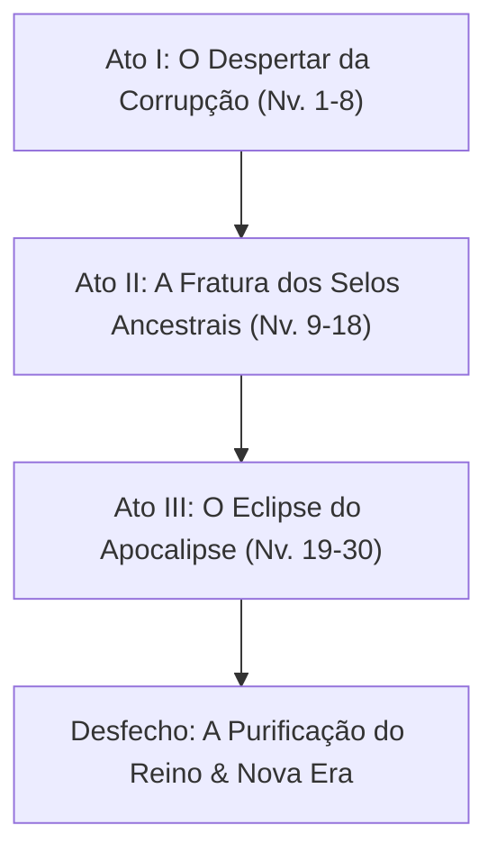

# 📖 PROMPT 4: Escopo Narrativo, Reestruturação dos Chefões e Cartografia do Mundo

> **Objetivo**: Fornecer um framework completo para que o desenvolvedor possa escrever e integrar a história de "A Lenda Perdida". Este documento reestrutura a **quantidade e hierarquia dos 16 Chefões**, alinha as **regiões e mapas (`.txt`)** ao roteiro e entrega templates práticos para escrever cutscenes e diálogos no motor de história (`historia/dialogos.txt`).

---

## 🗺️ PARTE 1: Escopo e Estrutura Narrativa (Os 3 Atos)

Preencha os campos abaixo com o lore, nomes e motivações do seu universo:

### 📜 Visão Geral do Universo
- **Nome do Continente**: *Valoria / Eldoria / Reino de Aethelgard*
- **A Grande Ameaça**: A *Entidade Maligna* (uma divindade esquecida selada há milênios no Santuário Sombrio que despertou após a quebra do equilíbrio elemental).
- **O Herói**: Um jovem morador da Vila Aurora que carrega a marca ancestral dos Guardiões Primordiais.
- **O Mentor**: O Ancião da Vila, guardião dos registros antigos e das profecias.

---

### 🎭 Estrutura dos 3 Atos



#### Ato I: O Despertar da Corrupção (Níveis 1 ao 8)
- **Cenário**: Vila Aurora, Floresta Esmeralda e Rio Cristalino.
- **Enredo**: O herói acorda em sua cabana com pesadelos vívidos de destruição. O Ancião alerta que o fluxo das águas e a fauna foram corrompidos por uma energia violácea.
- **Objetivo Principal**: Investigar o Covil dos Slimes e restaurar a primeira fonte de energia na Floresta.
- **Clímax do Ato**: Ao derrotar o Rei Slime, uma fissura mística se abre no horizonte, revelando que os selos de todo o continente estão ruindo simultaneamente.

#### Ato II: A Fratura dos Selos Ancestrais (Níveis 9 ao 18)
- **Cenário**: Lago Cristalino, Ruínas Antigas, Deserto dos Sussurros e Cavernas Congeladas.
- **Enredo**: Para impedir que a barreira do Santuário se rompa completamente, o herói deve reunir as **6 Relíquias dos Guardiões Antigos** espalhadas pelas terras esquecidas.
- **Reviravolta (Plot Twist)**: Ao entregar as relíquias, o herói descobre que não eram chaves de contenção, mas sim selos colocados para adormecer os próprios titãs que defendiam o mundo. A corrupção já tomou conta da maioria deles, forçando o herói a purificá-los pelo combate.

#### Ato III: O Eclipse do Apocalipse (Níveis 19 ao 30)
- **Cenário**: Pântano Sombrio, Necrópole, Céu Avermelhado e Santuário das Trevas.
- **Enredo**: O sol é encoberto por um eclipse místico permanente. As vilas acendem tochas de emergência e criaturas das sombras rondam os portões.
- **Objetivo Principal**: Cruzar os 4 Portais Celestiais que bloqueiam a torre central do Santuário e confrontar a Entidade Maligna no Coliseu das Eras.
- **Desfecho**: Vitória, créditos com alvorecer festivo e desbloqueio do **Modo Chefões** e do **New Game+**.

---

## ⚔️ PARTE 2: Reestruturação da Quantidade e Hierarquia dos Chefões

Para que as lutas não pareçam encontros aleatórios, os **16 Chefões** são divididos em 4 categorias narrativas com propósito claro:

| Categoria | Quantidade | Papel Narrativo | Exemplo de Chefes | Recompensa Principal |
|---|:---:|---|---|---|
| **Guardiões das Relíquias** (Masmorras da Campanha) | **6** | Chefes obrigatórios dos 6 grandes biomas; guardam as Relíquias Ancestrais que o Ancião estuda. | Rei Slime, Golem de Pedra, Colosso do Deserto, Ceifador do Pântano, Valquíria do Gelo, Titã Vulcânico | Relíquia do Bioma + Aumento permanente de HP |
| **Arautos do Eclipse** (Portais do Santuário) | **4** | Generais da Entidade Maligna que guardam os 4 pilares do Santuário no Ato III. | Quimera das Sombras, Arquimago Corrompido, Paladino Caído, Dragão Arcano | Chaves dos Selos Abissais + Magias Avançadas |
| **Lendas Ocultas** (Chefes Opcionais / Secretos) | **5** | Desafios de alto nível escondidos atrás de quebra-cabeças no mapa mundi para exploradores dedicados. | Yeti das Cavernas, Bruxa do Pântano Profundo, Kraken das Dunas, Cavaleiro Fantasma, Golem de Cristal | Armas Lendárias, Escudos de Ouro e Conquistas Raras |
| **Soberano do Apocalipse** (Chefe Final) | **1** | A Entidade Maligna em duas fases (Forma Sombria e Avatar Cósmico no Coliseu das Eras). | Entidade Maligna Chefe | Zera a Campanha, Salva o Reino e Libera o Modo Chefões |

> **Total**: **16 Chefões** balanceados com progressão orgânica do Nível 1 ao 30.

---

## 🗺️ PARTE 3: Cartografia e Conexão dos Mapas (`maps/*.txt`)

Para transformar o mundo em uma experiência coesa (estilo *Metroidvania* com backtracking recompensador):

### 1. Hub Central & Enlaces Geográficos
- **`maps/vila.txt` (Vila Aurora)**: O coração seguro da aventura. Abriga o Ancião, o Ferreiro, a Taverna, o Mercador e o Monólito Astral de Teleporte nº 1.
- **`maps/mundo.txt` (Encruzilhada Central)**: O mapa-múndi aberto que conecta as 4 direções cardeais:
  - **Norte**: `maps/ruinas.txt` ➔ `maps/santuario.txt` (Bloqueado no Ato I por portão rúnico).
  - **Sul**: `maps/bosque_outono.txt` ➔ `maps/pantano.txt` ➔ `maps/sepulcro_ceifador.txt`.
  - **Leste**: `maps/deserto.txt` ➔ `maps/oasis.txt` ➔ `maps/abismo_dunas.txt`.
  - **Oeste**: `maps/lago.txt` ➔ `maps/pico_congelado.txt` ➔ `maps/covil_yeti.txt`.

### 2. Bloqueios & Desbloqueios por Habilidades
- **Teias e Vinhas Negras**: Destruídas somente após aprender a **Esfera de Fogo** (`[F]`).
- **Paredes Rachadas com Símbolo de Fenda**: Explodidas com **Bombas** (`[B]`).
- **Pedras Cúbicas Pesadas**: Empurradas após obter a **Luva dos Titãs** nas Ruínas Antigas.
- **Abismos e Fendas Aquáticas**: Cruzados usando o **Dash de Esquiva** (`[Shift]`) ou saltando em ilhotas flutuantes.

---

## 📝 PARTE 4: Template de Roteiro e Cutscenes (`historia/dialogos.txt`)

Copie e adapte os blocos abaixo para escrever suas próprias cenas no arquivo de história:

### 1. Diálogo com Escolhas Ramificadas (`@opcao`)
```text
=== conversa_anciao_vila
Ancião da Vila: O vento sussurra presságios sombrios vindos do norte, meu jovem.
Ancião da Vila: Você sente a energia das Relíquias pulsando em seu peito?
@opcao O que devo fazer agora? -> anciao_dica_missao
@opcao Ancião, entregarei as relíquias que encontrei -> anciao_reliquias
@opcao Preciso apenas descansar e recuperar minhas forças -> anciao_cura
@opcao Estou pronto para enfrentar o que vier -> anciao_despedida

=== anciao_dica_missao
Ancião da Vila: A oeste fica o Lago Cristalino. Espíritos antigos habitam as ilhas floridas e guardam o Fragmento das Marés. Tenha cuidado com as criaturas aquáticas!

=== anciao_cura
@curar
Ancião da Vila: As águas da nossa fonte restauraram sua vitalidade e mana. Que os ancestrais protejam sua lâmina!
```

### 2. Cutscene Cinemática com Efeitos e Movimento de Câmera
```text
=== cutscene_despertar_santuario
@clima noite
@clarao roxo
@tremer 5 1.5
@pose heroi assustar
- Uma tempestade de relâmpagos púrpuras rasga o horizonte acima do Santuário Sombrio...
@camera 160 50
@esperar 1.0
@efeito fogo heroi
Voz das Sombras: MORTAL INSIGNIFICANTE... OS QUATRO SELOS FORAM QUEBRADOS!
Voz das Sombras: O APOCALIPSE NÃO PODE MAIS SER CONTIDO POR SUAS MÃOS FRÁGEIS!
@clarao branco
@tremer 3 0.8
@camera heroi
@pose heroi poder
Herói: Enquanto esta lâmina brilhar, o reino de Aurora não cairá nas trevas!
@marcar santuario_desperto
```

---

## 🚀 Como Aplicar Este Escopo no Jogo

1. **Escreva seus diálogos**: Abra [historia/dialogos.txt](file:///home/rafael/Workspace/jogo-teste-python/historia/dialogos.txt) e preencha ou substitua as falas dos personagens seguindo os comandos `@`.
2. **Adicione ou reposicione NPCs**: Abra o mapa desejado em `maps/*.txt` (ou use o editor visual com `[F2]`) e posicione os números dos NPCs correspondentes.
3. **Teste em tempo real**: Pressione **`[F5]`** a qualquer momento durante o jogo para recarregar a história instantaneamente sem reiniciar a aplicação!
